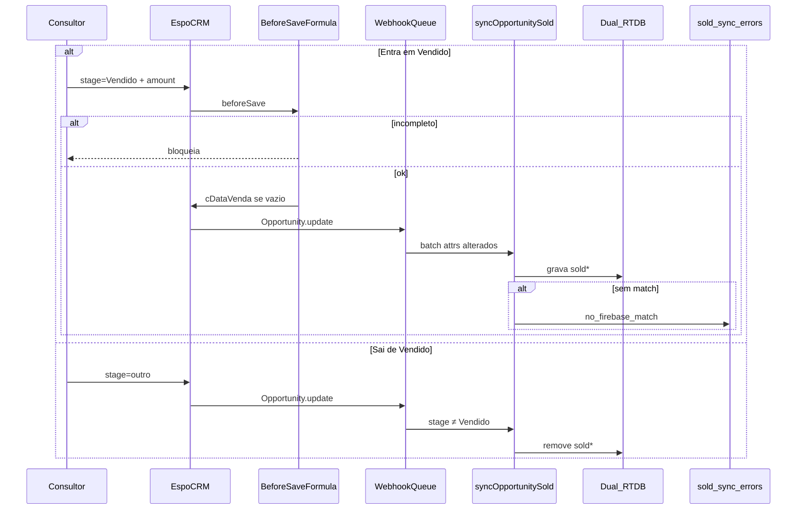

# Sync Opportunity `Vendido` → Firebase

**Status:** Fase 4 OK (2026-09-05) — E2E PROD passou; **monitor 72h** em andamento  
**Offline Ads (código):** [`ADS_OFFLINE_VENDIDO_FIREBASE.md`](ADS_OFFLINE_VENDIDO_FIREBASE.md) — Fase 1 no CF (`enabled: false`); smoke/cutover = Fases 2–3
**Hardening / runbook:** [`FASE3_HARDENING_SOLD_SYNC.md`](FASE3_HARDENING_SOLD_SYNC.md)  
**DEV:** [`FASE2_ESPO_DEV_VENDIDO_FIREBASE.md`](FASE2_ESPO_DEV_VENDIDO_FIREBASE.md)  
**PROD:** [`FASE4_ESPO_PROD_VENDIDO_FIREBASE.md`](FASE4_ESPO_PROD_VENDIDO_FIREBASE.md)  
**Próximo:** checks D1–D2 no log de monitor (até ~2026-09-08); script `monitor-sold-sync-check.mjs`  
**Smoke HTTP:** [`SMOKE_SYNC_OPPORTUNITY_SOLD.md`](SMOKE_SYNC_OPPORTUNITY_SOLD.md)  
**Código:** [`firebase/functions/sold-sync.js`](../firebase/functions/sold-sync.js) · export `syncOpportunitySold`  
**Plano:** fases 0→4 com aprovação individual entre fases.

## 1. Objetivo

Espelhar no Firebase Realtime Database o estado comercial de venda da Opportunity no EspoCRM:

| Evento Espo | Ação Firebase |
|---|---|
| Stage **passa a** `Vendido` (antes ≠ `Vendido`) | **set** — gravar campos `sold*` |
| Stage **sai de** `Vendido` (novo stage ≠ `Vendido`) | **clear** — apagar todos os campos `sold*` |

Ordem de ambientes: **1º** `dev.flyingdonkeys.com.br` → validar → **2º** `flyingdonkeys.com.br`.

Placar comercial decisório continua lendo **Espo** (`stage` / `amount` / `cDataVenda`). O Firebase passa a ter **cópia operacional** para joins e relatórios futuros.

## 2. Escopo Firebase (dual RTDB)

| Projeto | Path | Origem típica |
|---|---|---|
| `imediato-seguros-site-novo` | `leads_backup/{leadId}` | Site novo |
| `leads-imediato-seguros` | `leads_backup/{leadId}` | Site legado (Webflow) |

A Cloud Function tenta match nos **dois** bancos em cada evento.

## 3. Contrato de campos (`sold*`)

Gravação sempre com `.update()` **sem** `autoSync: true` (não rearmar `deliverLead`).

### 3.1 Ação `set`

| Campo RTDB | Valor | Tipo |
|---|---|---|
| `soldStatus` | `"vendido"` | string |
| `sold` | `true` | boolean |
| `soldCommissionAmount` | Opp.`amount` (Valor Comissão) | number |
| `soldStatusChangedAt` | clock do servidor CF no webhook | ISO-8601 |
| `soldDate` | Opp.`cDataVenda` | string `YYYY-MM-DD` (formato Espo) |
| `soldEspoOpportunityId` | Opp.`id` | string |
| `soldSyncedAt` | clock CF | ISO-8601 |
| `soldSyncSource` | `"espo_webhook"` | string |

### 3.2 Ação `clear`

Remover **todas** as chaves acima (Firebase: `.update({ campo: null })`).

**Não** apagar / alterar: `status`, `synced`, `autoSync`, `espocrmLeadId`, `espocrmOpportunityId`, `data.*`, flags de entrega Espo/Octadesk.

### 3.3 Validação na entrada em `Vendido`

No Espo (Before Save Formula + Dynamic Logic) e na CF (defesa):

- `stage === "Vendido"` exige **`amount` preenchido e ≠ 0** e **`cDataVenda` preenchida**.
- Se faltar qualquer um (ou `amount == 0`) → **bloquear** o save no Espo (`throwException`).
- Na CF `action=set`, se vier incompleto → HTTP 4xx + e-mail de erro (não gravar parcial).

Na ação `clear`, `amount` / `cDataVenda` **não** são obrigatórios.

## 4. Lookup (ordem)

Em cada RTDB, localizar nó(s) `leads_backup/{id}`:

1. `espocrmOpportunityId` === Opp.`id`
2. Senão: `espocrmLeadId` === Opp.`cLeadId` (quando `cLeadId` presente)
3. Senão: gclid em `utm.gclid` / `data.GCLID_FLD` / `gclid` / raiz === Opp.`cGclid`
   - **Legado (`leads-imediato-seguros`)**: query indexada em `data/GCLID_FLD` (`.indexOn` nas regras do banco desde 2026-10-20). No legado nenhum registro tem IDs do Espo, então o gclid é o único vínculo. O scan anterior baixava `leads_backup` inteiro (~17 MB) a cada webhook e gerou ~300 GB/semana de banda de saída (≈ R$ 270 por dia útil) entre 2026-09-08 e 2026-10-20.
   - **Site novo**: scan de `leads_backup` (sem índice de gclid; quase todos os registros já casam pelos IDs).

Atualizar **todos** os nós que casarem no passo que venceu (ex.: várias jornadas com o mesmo Opp id).

Se **nenhum** match em nenhum dos dois RTDBs → log + e-mail para `lrotero@gmail.com` / `alexkaminski70@gmail.com` / `alex.kaminski@imediatoseguros.com.br` (sem inventar registro).

## 5. Endpoint Cloud Function (contrato HTTP — Fase 1)

- **Nome sugerido:** `syncOpportunitySold`
- **Método:** `POST`
- **Auth:** header `X-Espo-Webhook-Secret: <secret>` (Firebase Secret)
- **Projeto de deploy:** `imediato-seguros-site-novo` (acessa o RTDB legado via segundo Admin app + IAM)

### 5.1 Body JSON

```json
{
  "action": "set",
  "opportunityId": "xxxxxxxxxxxxxxxxxxxxxxxxx",
  "stage": "Vendido",
  "previousStage": "Cotação Enviada",
  "amount": 439.5,
  "cDataVenda": "2026-09-04",
  "cLeadId": "yyyyyyyyyyyyyyyyyyyyyyyyy",
  "cGclid": "CjwK...",
  "modifiedAt": "2026-09-05 12:34:56"
}
```

| Campo | `set` | `clear` |
|---|---|---|
| `action` | `"set"` | `"clear"` |
| `opportunityId` | obrigatório | obrigatório |
| `stage` | deve ser `"Vendido"` | estágio novo (≠ Vendido) |
| `previousStage` | recomendado (≠ Vendido) | recomendado (`"Vendido"`) |
| `amount` | obrigatório (number > 0 ou não vazio) | opcional |
| `cDataVenda` | obrigatório | opcional |
| `cLeadId` | opcional (fallback) | opcional |
| `cGclid` | opcional (fallback) | opcional |
| `modifiedAt` | opcional (auditoria) | opcional |

Nomes exatos do payload Espo Webhook podem variar; a CF normaliza aliases (`id` → `opportunityId`, etc.) e infere `action` a partir de `stage`.

### 5.2 Respostas

| Código | Significado |
|---|---|
| 200 | set/clear aplicado ou no-op idempotente |
| 401 | secret inválido |
| 400 | payload inválido (ex.: set sem amount/cDataVenda; action desconhecida) |
| 404 | sem match Firebase (também dispara e-mail) |
| 500 | falha interna / RTDB |

**Idempotência:**

- `set` com mesmos `soldCommissionAmount` + `soldDate` + já `sold===true` → 200 no-op.
- `clear` sem nenhum campo `sold*` → 200 no-op.

## 6. Configuração Espo (Fases 2 DEV / 4 PROD)

Mesmo desenho nos dois ambientes (paridade):

1. Before Save Formula (auto `cDataVenda` + bloqueio sem `amount`)
2. Dynamic Logic (`amount` required se stage = Vendido)
3. Webhook nativo `Opportunity.update` → CF `syncOpportunitySold`

**PROD não usa Workflow na Fase 4** (Advanced Pack fica como evolução opcional). Ver plano atualizado e runbook Fase 4.

### 6.1 Before Save Formula (Opportunity)

Canônico (PROD aplicado 2026-09-26; espelhar em DEV):

```text
ifThen(
  entity\isAttributeChanged('stage') && stage == 'Vendido' && (cDataVenda == null || cDataVenda == ''),
  cDataVenda = datetime\now()
);

ifThen(
  entity\isAttributeChanged('stage') && stage == 'Vendido' && (amount == null || amount == '' || amount == 0),
  throwException('Para marcar como Vendido, preencha Valor Comissão (amount).')
);
```

**Nota 2026-09-26:** a condição passou a incluir `amount == 0` (antes só `null` / `''`). Opps já em `Vendido` com amount 0 **não** disparam a Formula de novo até um re-save / nova mudança de stage — preencher amount e salvar de novo para gerar `sold*` no Firebase.

**Nota 2026-09-29 (DEV):** neste Espo, `amount == 0` não casa com o zero do campo moeda (`amount <= 0` casa). O DEV gravou `amount <= 0` nos scripts personalizado e de API. O PROD permanece com o texto de 26/09.

### 6.2 Dynamic Logic

Quando `stage = Vendido`: campo `amount` **required** na UI (e backend conforme versão Espo). Preferir também valor ≠ 0 (a Formula é a barreira canônica para zero).

### 6.3 Webhook nativo (DEV e PROD)

| Campo | Valor |
|---|---|
| Event | `Opportunity.update` (opcional depois: `Opportunity.fieldUpdate.stage`) |
| URL | `https://us-central1-imediato-seguros-site-novo.cloudfunctions.net/syncOpportunitySold` |
| Active | sim |
| Auth CF | Signature Espo → secret `ESPO_WEBHOOK_AUTH` (`id` + `secretKey` **do ambiente**) |

A CF infere `action=set` se `stage=Vendido`, senão `clear` se `stage` veio no payload; enriquece Opp via API (**também no clear**: completa `cLeadId` / click IDs / `cWebpage` / `leadSource` quando faltam — evita `no_firebase_match` falso se `espocrmOpportunityId` no RTDB estiver stale). Match por `espocrmLeadId` com OppId divergente **reconcilia** `espocrmOpportunityId` no Firebase (sem `autoSync`).

`no_firebase_match` grava `missClass` em `sold_sync_errors/`; e-mail só para classes `actionable_*` (ver [`FASE3_HARDENING_SOLD_SYNC.md`](FASE3_HARDENING_SOLD_SYNC.md)).

**Não** ativar Workflow Send HTTP Request em paralelo com este Webhook (eventos duplicados).

### 6.4 Workflow (fora da Fase 4)

Evolução opcional pós-estabilização: 2 rules After update com condições `changed` / `was equal` + Send HTTP Request e payload `action` explícito — **somente após desligar** o Webhook nativo do mesmo evento.

## 7. Fluxo



## 8. Fases e gates

| Fase | Entrega | Gate |
|---|---|---|
| **0** | Contrato neste doc | Aprovado 2026-09-05 |
| **1** | CF + secrets + dual RTDB; Espo desligado | Smoke HTTP set + clear |
| **2** | Espo DEV (formula + webhook) + E2E | Ponta a ponta DEV |
| **3** | Hardening / runbook | Ops pronto — aceite 2026-09-05 |
| **4** | Espo PROD **espelho DEV (Webhook)** + monitor | Vendas reais; CRM intacto |

**Fora de escopo (sync Vendido atual):** placar passar a ler Firebase no lugar do Espo; PHP custom no servidor Espo; Workflow na Fase 4.  
**Offline Conversion Ads:** código Fase 1 em [`ADS_OFFLINE_VENDIDO_FIREBASE.md`](ADS_OFFLINE_VENDIDO_FIREBASE.md) (`ads-offline-conversion.js`, secret com `enabled:false`); upload em produção = Fases 2–3.

## 9. Critério de aceite da Fase 0

- [x] Contrato `set` / `clear` documentado
- [x] Lista de campos `sold*` e regra de limpeza
- [x] Lookup e dual RTDB definidos
- [x] Payload HTTP e auth definidos
- [x] Rascunho Formula / Dynamic Logic / Webhook (Workflow opcional pós-Fase 4)
- [x] E-mail de erro e destinatário definidos
- [x] Aprovação explícita da Fase 0

## 9.1 Critério de aceite da Fase 1

- [x] Módulo `sold-sync.js` + export HTTP `syncOpportunitySold`
- [x] Auth `X-Espo-Webhook-Secret` (`ESPO_SOLD_WEBHOOK_SECRET`)
- [x] Dual RTDB (site novo + legado)
- [x] Lookup OppId → LeadId → gclid; set/clear; sem `autoSync`
- [x] Índices `espocrmOpportunityId` / `espocrmLeadId` em `database.rules.json` (site novo)
- [x] Testes unitários: `node scripts/espo-ops/sold-sync-unit-test.mjs`
- [x] Runbook smoke: [`SMOKE_SYNC_OPPORTUNITY_SOLD.md`](SMOKE_SYNC_OPPORTUNITY_SOLD.md)
- [ ] Deploy Firebase + secret + smoke HTTP real (operacional — ver smoke doc)
- [ ] IAM SA no RTDB legado (operacional)

**Próximo passo:** aguardar **“Aprovo Fase 2”** (ligar Espo DEV). Deploy/smoke da CF pode ser feito antes ou no início da Fase 2.

## 10. Referências

- Arquitetura captura: [`ARQUITETURA_LEADS_FIREBASE_CLOUD_FUNCTION.md`](ARQUITETURA_LEADS_FIREBASE_CLOUD_FUNCTION.md)
- Placar comercial: [`EXPERIMENTO_PLACAR_COMERCIAL_ESPO.md`](EXPERIMENTO_PLACAR_COMERCIAL_ESPO.md)
- Medição venda: [`MEDICAO_VENDA_POR_TIPO_LEAD.md`](MEDICAO_VENDA_POR_TIPO_LEAD.md)
- Firebase deploy: [`firebase/README.md`](../firebase/README.md)
