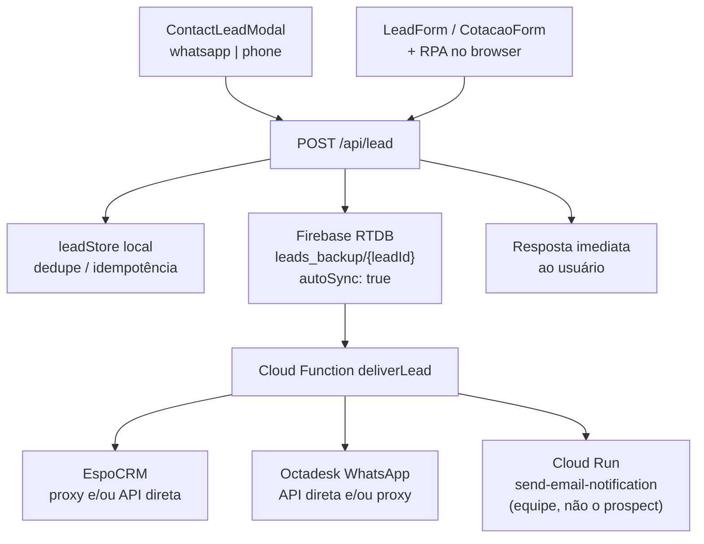

# Fluxo de leads — Modal (telefone/WhatsApp), formulário de cotação e RPA

## Finalidade

Documentar, de ponta a ponta, como o site novo captura leads nos **modais de telefone e WhatsApp** e no **formulário de cotação com RPA**, e como isso chega a **EspoCRM**, **Octadesk** e **e-mail admin**.

- Comportamento esperado do LeadForm (etapas e templates): [`FLUXO_LEADFORM_CRM_WHATSAPP.md`](./FLUXO_LEADFORM_CRM_WHATSAPP.md)
- Arquitetura Firebase + Cloud Function: [`ARQUITETURA_LEADS_FIREBASE_CLOUD_FUNCTION.md`](./ARQUITETURA_LEADS_FIREBASE_CLOUD_FUNCTION.md)
- Templates Octadesk / Meta: [`GUIA_OCTADESK_TEMPLATES.md`](./GUIA_OCTADESK_TEMPLATES.md)

A jornada Suhai (`/cotacao-suhai`, `captureChannel: "suhai_form"`) usa o mesmo caminho `/api/lead` → Firebase → `deliverLead`, com estágios próprios: [`FLUXO_SUHAI_CRM_WHATSAPP.md`](./FLUXO_SUHAI_CRM_WHATSAPP.md).

---

## 1. Arquitetura em uma frase

O Next.js **não** chama EspoCRM, Octadesk nem e-mail. O caminho é:

```text
UI → POST /api/lead → store local + Firebase RTDB (leads_backup/{leadId})
   → Cloud Function deliverLead → EspoCRM / Octadesk / e-mail admin
```



---

## 2. Dois canais de captura

| Canal | UI | `captureChannel` | Destino do usuário após envio |
|---|---|---|---|
| Modal WhatsApp / telefone | `components/cta/ContactLeadModal.tsx` | `contact_modal` | `wa.me` ou `tel:` |
| Formulário de cotação | `components/lead/LeadForm.tsx` (via `CotacaoForm.tsx`) | `lead_form` | `/obrigado`, tela RPA ou WhatsApp do resultado |
| Cotação Suhai | `components/suhai/CotacaoSuhaiForm.tsx` (via `CotacaoSuhaiExperiencia.tsx`) | `suhai_form` | Preço na tela, escolha do plano e proposta com boleto |

Botões que abrem o modal: `WhatsAppButton`, `WhatsAppFAB`, `StickyCTA` (`channel: "whatsapp"`); `CallButton`, `FooterPhoneLink` (`channel: "phone"`). Provider em `app/layout.tsx`.

Cliente HTTP: `lib/leads/post-lead.ts` (Turnstile invisível, fail-open).

---

## 3. Modal de telefone e WhatsApp

### 3.1 Passos do usuário

1. Clique em WhatsApp ou Ligar → abre o modal (`ContactModalContext`).
2. **Etapa 1**: DDD + celular. No blur do celular válido → dispara `stage: "initial"` e revela a etapa 2.
3. **Etapa 2** (opcional, ordem do legado): CPF → e-mail → nome → CEP → placa (ficha Placa Fipe somente-leitura).
4. Submit ou “Prosseguir sem preencher o resto” → `stage: "complete"` + navega para WhatsApp/`tel:`.
5. Dispensar (× / Esc / clique fora) → navega **sem** `complete` (se o blur já rodou, o `initial` já foi enviado).

A navegação **não depende** do sucesso de `/api/lead` (nunca perder a conversão por falha de rede).

Telefone e WhatsApp usam o **mesmo** pipeline CRM/Octadesk; mudam destino de navegação, eventos de analytics e `cCanalCaptura` (`telefone` vs `whatsapp`).

### 3.2 Estágios e integrações (modal)

| Stage | EspoCRM | Octadesk | E-mail admin |
|---|---|---|---|
| `initial` | Cria Lead + Opportunity (nome/e-mail simulados se vazios) | Template `primeira_etapa` (1×) | Após sucesso Espo e/ou Octa |
| `complete` | Atualiza o mesmo Lead | Se houver dados além do telefone: `cotacao_dados_recebidos` | Update Espo |
| `complete` só telefone / skip sem extras | Atualiza | **Sem** segunda HSM | Update Espo |

Fallbacks na Cloud Function quando nome/e-mail vazios:

- Nome: `{ddd}-{celular}-NOVO CLIENTE WHATSAPP`
- E-mail: `{ddd}{celular}@imediatoseguros.com.br`

---

## 4. Formulário de cotação (`LeadForm`) + RPA

### 4.1 Passos da UI

| Passo | Conteúdo | Stage enviado |
|---|---|---|
| 1 | DDD + celular | `initial` |
| 2 | Nome + e-mail | `progress` |
| 3 | CPF + CEP + placa | `progress` |
| 4 | Escolha RPA vs consultor | `complete` / `consultant_requested` / depois `rpa_result` |

Arquivos: `LeadForm.tsx`, `RpaChoiceStep.tsx`, `RpaCalculationScreen.tsx`, `lib/leads/use-rpa-calculation.ts`, `lib/rpa.ts`.

### 4.2 Escolha no passo 4

**Aguardar cálculo automático** (`rpaChoice: "aguardar"`)

1. `complete` no Firebase/Espo (Note: prospect acompanha o RPA; funil “Aguardando cálculo”).
2. Abre a tela de progresso.
3. Browser: `POST` em `rpaimediatoseguros.com.br/api/rpa/start` + poll de progresso.
4. Ao terminar: `stage: "rpa_result"` com `rpaResultado` (valores, franquias, status).
5. Sem redirect automático para `/obrigado`.

**Prefiro consultor / cálculo depois**

1. `complete` → `/obrigado`; só depois da resposta do `complete`, `consultant_requested` (último POST, `keepalive`). A Cloud Function descarta o `cEtapaFunil` de uma execução cujo `data` já foi regravado, então a escolha precisa ser a última gravação (achado do UAT de 2026-10-19). Na etapa 3 o `consultant_requested` também leva `skipStrictValidation`.
2. Espo: Note + Task “Efetuar cálculo manual”.
3. Octadesk: `calculo_completo_depois`.

### 4.3 Depois do RPA (`rpa_result`)

| Resultado | EspoCRM | Octadesk |
|---|---|---|
| Sucesso com valor | Note + description na ficha | `calculo_pronto` (nome, veículo, valor) |
| Falha / sem valor | Note + Task de cálculo manual | `calculo_manual` |

O LeadForm **nunca** dispara `cotacao_dados_recebidos` no `complete` (`captureChannel: "lead_form"`).

O RPA **não** fala com Espo/Octadesk; só o estágio `rpa_result` no Firebase faz isso.

---

## 5. Camada `/api/lead`

Arquivo: `app/api/lead/route.ts` (Node, não edge).

Ordem: idempotência → rate limit → Zod → honeypot → Turnstile → E.164 → dedupe 24h → store local → PH3A (best-effort no complete) → `saveLeadBackupToFirebase()` → resposta imediata.

**Não** chama EspoCRM, Octadesk nem e-mail.

Estágios: `initial` | `progress` | `complete` | `rpa_result` | `consultant_requested` (`lib/leads/types.ts`).

Persistência:

- Local: `lib/leads/store.ts` (efêmero na Vercel; dedupe/idempotência)
- Firebase: `lib/leads/firebase-backup.ts` → `leads_backup/{leadId}`, `autoSync: true`, `.update()` entre fases

---

## 6. Cloud Function `deliverLead` — matriz por estágio

Arquivo: `firebase/functions/index.js`. Trigger: `onValueWritten` em `/leads_backup/{leadId}`.

| Stage | Criar/atualizar ficha Espo (proxy ou API) | Octadesk inicial | Templates Octadesk extras | Notes / Tasks Espo |
|---|---|---|---|---|
| `initial` | Cria se ainda não enviado | Sim (1×) | — | Funil, canal, UTM |
| `progress` | Atualiza | Não | — | Funil |
| `complete` | Atualiza | Não | Só modal + extras → `cotacao_dados_recebidos` | Note se `rpaChoice=aguardar` |
| `rpa_result` | Enrich API (não proxy “cheio”) | Não | `calculo_pronto` ou `calculo_manual` | Note + description; Task se falhou |
| `consultant_requested` | Enrich API | Não | `calculo_completo_depois` | Note + Task |

`cCanalCaptura`: `formulario` | `whatsapp` | `telefone`.

Ambientes: Espo DEV/staging vs PROD pelo `environment` do registro; Octadesk sempre o endpoint de produção.

---

## 7. Payloads (resumo)

### Proxy legado Espo / Octadesk

Campos no estilo `DDD-CELULAR`, `CELULAR`, `NOME`, `Email`, `CPF`, `CEP`, `PLACA`, `VEICULO`, `ANO`, UTMs, `webpage`, opcionalmente `lead_id` / `opportunity_id`.

### Octadesk API direta

`POST …/chat/send-template` com origem/destino WhatsApp e variáveis do template (`firebase/functions/octadesk.js`).

| Key no secret | Uso |
|---|---|
| `primeira_etapa` | Mensagem inicial (sem variáveis) |
| `cotacao_dados_recebidos` | Modal complete com extras |
| `calculo_pronto` | RPA sucesso |
| `calculo_manual` | RPA falhou |
| `calculo_completo_depois` | Escolheu consultor |

### E-mail admin

Cloud Run `send-email-notification` — destino da **equipe**, não do prospect. Momentos: `initial`, `update`, `initial_error`, `update_error`. Flags de dedupe no RTDB.

---

## 8. Comparativo rápido

| | Modal WA/Tel | LeadForm + RPA |
|---|---|---|
| Obrigatório no início | Telefone | Telefone |
| `progress` | Não | Sim (passos 2 e 3) |
| RPA | Não | Passo 4 |
| Octadesk 1ª msg | `primeira_etapa` | Idem |
| Octadesk 2ª msg | `cotacao_dados_recebidos` se extras | `calculo_*` / consultor |
| Depois do envio | Abre WA ou liga | Tela RPA ou `/obrigado` |

---

## 9. O que este fluxo não faz

- Não cobre a cotação/proposta Suhai: ver [`FLUXO_SUHAI_CRM_WHATSAPP.md`](./FLUXO_SUHAI_CRM_WHATSAPP.md).
- `/api/lead` não garante entrega no CRM; só a gravação no Firebase.
- Templates Octadesk extras dependem de `OCTADESK_API_CONFIG.enabled` e IDs Meta.
- Chat `wa.me` do modal é paralelo ao HSM do Octadesk (não é a mesma coisa).
- PH3A demográfico alimenta o RPA; no proxy legado SEXO/DATA/ESTADO-CIVIL ficam vazios.

---

## 10. Arquivos-chave

| Papel | Caminho |
|---|---|
| Modal | `components/cta/ContactLeadModal.tsx` |
| Formulário | `components/lead/LeadForm.tsx`, `CotacaoForm.tsx` |
| API | `app/api/lead/route.ts` |
| Tipos / stages | `lib/leads/types.ts` |
| Firebase backup | `lib/leads/firebase-backup.ts` |
| CF entrega | `firebase/functions/index.js` |
| Espo API | `firebase/functions/espocrm.js` |
| Octadesk | `firebase/functions/octadesk.js` |
| E-mail | `firebase/functions/email-notification.js` |

---

*Elaborado a partir do código e da exploração do repositório (2026-10-15). Complementa [`FLUXO_LEADFORM_CRM_WHATSAPP.md`](./FLUXO_LEADFORM_CRM_WHATSAPP.md).*
