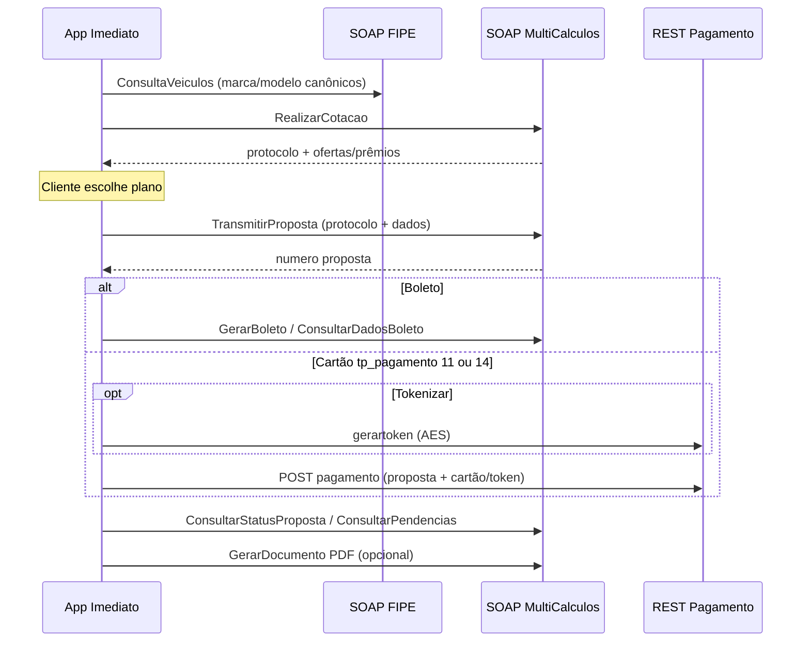

# 01 — Catálogo completo de integrações

Inventário de tudo publicado no espaço SUHAPI relevante a vendas + pagamento + pós-vendas.

---

## A. Vendas e multicálculos (SOAP)

### A1. WebService Cotação/Proposta

| | |
|---|---|
| Página | [WebService Cotação/Proposta](https://suhai.atlassian.net/wiki/spaces/SUHAPI/pages/457441285) |
| Homolog | `https://uat.integracao.suhaiseguradoracotacao.com.br/MultiCalculos.svc` *(path documentado sem scheme em alguns trechos; usar HTTPS)* |
| Produção | `suhaiseguradoracotacao.com.br:5156/MultiCalculos.svc` |
| Auth | Tags `login` / `senha` (Cotador) |

| Método SOAP (doc) | Função | Página Confluence |
|---|---|---|
| Realizar Cotação | Calcula prêmios / ofertas | [438370307](https://suhai.atlassian.net/wiki/spaces/SUHAPI/pages/438370307) |
| Transmitir Proposta | Formaliza contratação a partir do protocolo | [438632504](https://suhai.atlassian.net/wiki/spaces/SUHAPI/pages/438632504) |
| Consultar Status da Proposta | Status + pareceres | [438861937](https://suhai.atlassian.net/wiki/spaces/SUHAPI/pages/438861937) |
| Gerar Documento (PDF) da Proposta | PDF proposta | [439320637](https://suhai.atlassian.net/wiki/spaces/SUHAPI/pages/439320637) |
| Cancelar Proposta | Cancelamento com justificativa ≥30 chars | [439517311](https://suhai.atlassian.net/wiki/spaces/SUHAPI/pages/439517311) |
| Gerar Boleto 1ª parcela (PDF) | PDF boleto | [439156994](https://suhai.atlassian.net/wiki/spaces/SUHAPI/pages/439156994) |
| Consultar Dados do Boleto 1ª parcela | Dados do boleto | [439517233](https://suhai.atlassian.net/wiki/spaces/SUHAPI/pages/439517233) |
| Pesquisar Proposta | Busca propostas | [488276120](https://suhai.atlassian.net/wiki/spaces/SUHAPI/pages/488276120) |
| Consultar Dados da Proposta | Detalhe da proposta | [488276561](https://suhai.atlassian.net/wiki/spaces/SUHAPI/pages/488276561) |
| Consultar Pendências de Emissão | Pendências + links vistoria/rastreador | [615841800](https://suhai.atlassian.net/wiki/spaces/SUHAPI/pages/615841800) |

### A2. WebService FIPE SUHAI

| | |
|---|---|
| Página | [WebService FIPE SUHAI](https://suhai.atlassian.net/wiki/spaces/SUHAPI/pages/457441292) |
| Homolog | `uat.integracao.suhaiseguradoracotacao.com.br/veiculosfipe.svc?wsdl` |
| Produção | `suhaiseguradoracotacao.com.br:5156/veiculosfipe.svc?wsdl` |
| Método | `ConsultaVeiculos` — [Consulta Tabela FIPE SUHAI](https://suhai.atlassian.net/wiki/spaces/SUHAPI/pages/439484515) |

---

## B. API Pagamento (REST / Digibee)

Página índice: [API PAGAMENTO](https://suhai.atlassian.net/wiki/spaces/SUHAPI/pages/614596618)

| Método | Verbo | Homolog | Produção | Timeout |
|---|---|---|---|---|
| Insere Dados de Pagamento | POST | `test.godigibee.io/pipeline/suhaiseguradora/v1/pagamento` | `api.godigibee.io/pipeline/suhaiseguradora/v1/pagamento` | 60s |
| Gerar Token para Pagamento | POST | `…/v1/pagamento/gerartoken` | `…/v1/pagamento/gerartoken` | 60s |
| Configuração Criptografia AES | — (doc) | — | — | — |

Páginas: [614367422](https://suhai.atlassian.net/wiki/spaces/SUHAPI/pages/614367422) · [785383449](https://suhai.atlassian.net/wiki/spaces/SUHAPI/pages/785383449) · [637502157](https://suhai.atlassian.net/wiki/spaces/SUHAPI/pages/637502157)

---

## C. Pós-vendas (REST / Digibee)

Índice: [Integração para Gestão de Pós-Vendas](https://suhai.atlassian.net/wiki/spaces/SUHAPI/pages/437387464)

Base homolog: `https://test.godigibee.io/pipeline/suhaiseguradora/v1/…`  
Base produção: `https://api.godigibee.io/pipeline/suhaiseguradora/v1/…`

### C1. API Apólice

| Método | Verbo | Path | Timeout |
|---|---|---|---|
| Pesquisa de Apólice | GET | `/apolice/pesquisa` | 90s |
| Consulta de Apólice | GET | `/apolice/consulta` | 90s |
| Consulta de Parcelas | GET | `/apolice/parcela` | (doc) |
| Consulta de Parcelas Pagas | GET | `/apolice/parcelapaga` | (doc) |

### C2. API Comissão

| Método | Verbo | Path |
|---|---|---|
| Consulta de Comissão | GET | `/comissao` |

### C3. API Sinistro

| Método | Verbo | Path |
|---|---|---|
| Consulta de Sinistro | GET | `/sinistro/consulta` |
| Pesquisa de Sinistro | GET | `/sinistro/pesquisa` |

Docs transversais: [Padrões de Requisição e Resposta](https://suhai.atlassian.net/wiki/spaces/SUHAPI/pages/437289313) · [Padrões de Segurança](https://suhai.atlassian.net/wiki/spaces/SUHAPI/pages/473923876)

---

## D. Contagem

| Grupo | Itens acionáveis |
|---|---|
| SOAP cotação/proposta | 10 métodos |
| SOAP FIPE | 1 método |
| REST pagamento | 2 endpoints (+ doc AES) |
| REST pós-vendas | 7 endpoints |
| **Total** | **20 endpoints/métodos** + padrões |

---

## E. Ordem típica de venda (happy path)

