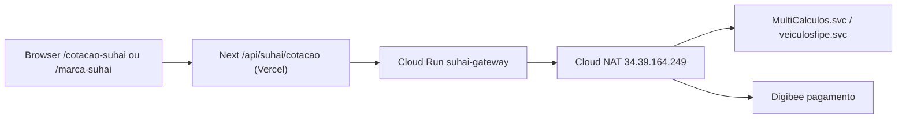

# 09 — Arquitetura implementada e estado atual

Atualizado em 2026-10-01. Diferente dos documentos 00 a 07, que descrevem a API da Suhai, este registra **o que existe de código e infraestrutura do nosso lado**. O estado do acesso ao Cotador está na seção 6. As duas páginas de UAT estão na seção 8.

---

## 1. Por que existe um gateway

A Suhai libera o acesso por whitelist de IP fixo. Funções serverless da Vercel não têm IP estável, então nenhuma chamada pode sair de lá. Todo tráfego passa por um serviço no Cloud Run com saída por Cloud NAT, que é o dono do IP autorizado e das credenciais.



O browser nunca fala com a Suhai. A Vercel também não: ela só orquestra e nunca vê login, senha ou chaves AES.

---

## 2. Infraestrutura provisionada

| Recurso | Valor |
|---|---|
| Projeto GCP | `imediato-seguros-site-novo` (o mesmo do Firebase) |
| Região | `southamerica-east1` |
| IP externo reservado | `suhai-egress-ip` = **34.39.164.249** |
| Cloud Router / NAT | `suhai-router` / `suhai-nat`, rede `default` |
| Serviço | `suhai-gateway`, privado (`--no-allow-unauthenticated`) |
| URL | `https://suhai-gateway-64754519959.southamerica-east1.run.app` |
| Invoker | `leadbackup-admin@imediato-seguros-site-novo.iam.gserviceaccount.com` |

O IP de saída foi confirmado na prática pelo endpoint `/diag/ip`, que respondeu exatamente o endereço reservado.

### Armadilhas descobertas

- **`/healthz` não funciona no Cloud Run**: o Google Frontend intercepta esse caminho e devolve 404 antes de chegar ao container. A rota de saúde chama-se `/status`.
- **Token OIDC exige service account**: credencial de usuário (`gcloud auth application-default login`) gera token com audiência errada e resulta em 403. Por isso o cliente usa a mesma service account do Firebase Admin, que já está configurada na Vercel.

---

## 3. Código

### `suhai-gateway/` (Node, Cloud Run)

| Arquivo | Responsabilidade |
|---|---|
| `server.js` | Rotas `/status`, `/diag/ip`, `/cotacao`, `/fipe/consulta` |
| `src/config.js` | Endpoints por ambiente, credenciais, tabela de comissão |
| `src/soap.js` | Envelope, escape XML, POST, SOAP Fault, conversão numérica |
| `src/cotacao.js` | `IncluirCotacaoSuhai`: monta os ~40 campos e lê o resultado |
| `src/fipe.js` | `ConsultaVeiculos`: consulta pontual e carga completa |
| `test/` | 10 testes com fixtures montados dos exemplos oficiais |

### Site (raiz do monorepo)

| Arquivo | Responsabilidade |
|---|---|
| `app/(marketing)/cotacao-suhai/page.tsx` | Cotação no visual da Imediato, `noindex` enquanto não for a produção |
| `app/(marca-suhai)/` | Landing no visual da Suhai e as páginas de moto, carro e caminhão. Ver seção 8 |
| `components/suhai/CotacaoSuhaiForm.tsx` | Formulário em três etapas |
| `components/suhai/OfertasSuhai.tsx` | Três planos + seletor de assistência |
| `app/api/suhai/cotacao/route.ts` | Valida, limita taxa e delega ao gateway |
| `lib/suhai/dominio.ts` | Enums da Suhai (sexo, uso, status, cores, pagamento) |
| `lib/suhai/planos.ts` | `cdCobertura` ↔ planos do site, nos dois sentidos |
| `lib/suhai/types.ts` | Schema Zod do pedido de cotação |
| `lib/suhai/normalizar.ts` | Cotação bruta do gateway → ofertas da UI |
| `lib/suhai/gateway.ts` | Cliente com token OIDC e tradução de erros |
| `lib/suhai/mock.ts` | Cotação simulada determinística |

A regra de produto (que código vira que plano) vive só em `planos.ts`. O gateway é transporte fiel: devolve as coberturas como a Suhai as envia.

---

## 4. Modo simulado

Sem `SUHAI_GATEWAY_URL`, ou quando o gateway responde que ainda não tem credenciais, a rota devolve uma cotação gerada por `lib/suhai/mock.ts`, sempre marcada com `simulado: true` — e a UI exibe um aviso. Os preços são determinísticos para que os testes tenham asserções estáveis.

Isso não é estimativa de preço real e não deve ser exposto ao público.

---

## 5. Variáveis de ambiente

No site (Vercel), documentadas em `.env.example`:

| Variável | Uso |
|---|---|
| `SUHAI_GATEWAY_URL` | URL do Cloud Run; vazia mantém o modo simulado |
| `SUHAI_GATEWAY_TIMEOUT_MS` | Padrão 30000 |
| `SUHAI_GATEWAY_TOKEN` | Atalho para ambientes sem credencial Google |
| `SUHAI_GATEWAY_SA_EMAIL` / `_SA_KEY` | Service account alternativa; sem elas usa a do Firebase |

No gateway (Cloud Run): `SUHAI_AMBIENTE`, `SUHAI_LOGIN`, `SUHAI_SENHA`, `SUHAI_TABELA_COMISSAO`, `SUHAI_URL_MULTICALCULOS`, `SUHAI_URL_FIPE`, `SUHAI_TIMEOUT_MS`.

---

## 6. O que falta para sair do simulado

Atualizado em 2026-09-30.

1. Login e senha do Cotador de homologação estão no Secret Manager (`SUHAI_LOGIN`, `SUHAI_SENHA`) e na revisão `suhai-gateway-00006-225`. `/status` confirma `credenciais: true` e `/diag/ip` confirma `34.39.164.249`.
2. `ConsultaVeiculos` em UAT passou para o código de exemplo da documentação (BAJAJ, BEE 125cv Monaco). O SOAPAction foi alinhado ao WSDL: `VeiculosFipe` na FIPE e `MultiCalculos` na cotação. A primeira revisão ainda usava `IMultiCalculos` e a Suhai respondia HTTP 500.
3. A cotação do caso piloto (placa `DBO7B72`) não foi enviada. A FIPE Suhai reconheceu o veículo (`005085-7`, `VW - VolksWagen`, `Golf 1.6 Black & Silver`, ano 2000). O perfil não saiu: a PH3A respondeu HTTP 500 (usuário ou senha inválidos). Sem código de recusa da seguradora.
4. `SUHAI_GATEWAY_URL` na Vercel continua vazio. A página `/cotacao-suhai` segue simulada e `noindex`.

O formulário de `/cotacao-suhai` preenche placa e CPF no blur. A cotação em si continua no gateway.

Nada disso exige credencial Suhai na Vercel.

---

## 7. Comandos úteis

```bash
# Testes do gateway
cd suhai-gateway && npm test

# Deploy
gcloud run deploy suhai-gateway --source . \
  --region southamerica-east1 --project imediato-seguros-site-novo \
  --no-allow-unauthenticated \
  --network=default --subnet=default --vpc-egress=all-traffic

# Conferir o IP de saída
curl -H "Authorization: Bearer $(gcloud auth print-identity-token)" \
  https://suhai-gateway-64754519959.southamerica-east1.run.app/diag/ip
```

---

## 8. Dois previews de UAT (2026-10-01)

A produção (`main` → `novo.segurosimediato.com.br`) não recebeu estas páginas. São dois deploys de Preview do projeto Vercel `imediato-seguros`, cada um com o alias público do branch.

| Papel | Branch | Endereço |
|---|---|---|
| Landing no visual da Suhai | `uat-marca-suhai` (`0ac3001`) | https://imediato-seguros-git-uat-marca-suhai-lucianooteros-projects.vercel.app/marca-suhai |
| Cotação no visual da Imediato | `uat-suhai` (`8a54876`) | https://imediato-seguros-git-uat-suhai-lucianooteros-projects.vercel.app/cotacao-suhai |

A landing tem home e três subpáginas (`/marca-suhai/moto`, `/carro`, `/caminhao`). Todas são `noindex` e ficam fora do menu e do sitemap. O formulário é o mesmo componente da cotação. Os cards de produto usam o véu de foto registrado em [`../SUHAI_CARDS_IMAGEM.md`](../SUHAI_CARDS_IMAGEM.md).

No host futuro `suhai.segurosimediato.com.br`, o `middleware.ts` mostra a landing em `/` e deixa passar só as três subpáginas. O DNS desse host não foi apontado.

Em 01/10/2026 as subpáginas passaram a abrir com o formulário na hero, no mesmo formato da home da landing: foto e título à esquerda, cotação à direita. No celular, o título fica em cima e o formulário logo abaixo. Essa alteração está no workspace do branch `uat-marca-suhai` e ainda não foi enviada ao preview, que continua no commit `0ac3001`.

O código emite `suhai_quote_start`, `suhai_quote_price` e `suhai_quote_abandon`. As tags do GTM não foram publicadas. `SUHAI_GATEWAY_URL` não foi definido em Production, e o experimento de Ads não foi aberto.
